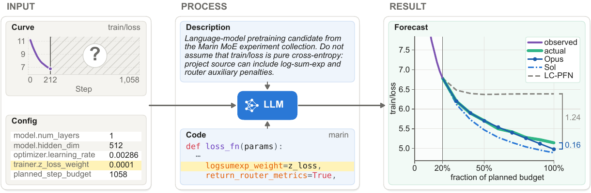
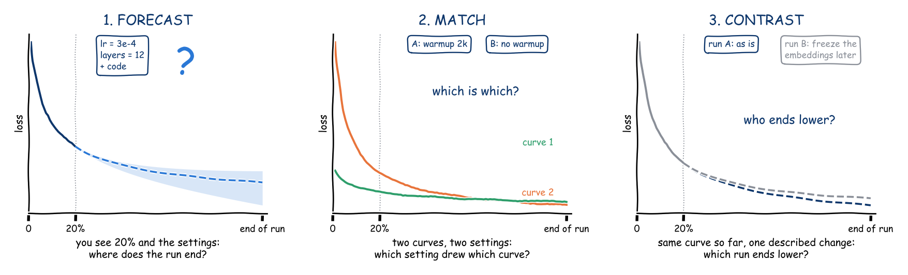

<div align="center">

# 🍵 Reading the Tea Leaves, Again

### Can Large Language Models Predict Language Model Training Runs?

[**Paper**](paper/tea-leaves.pdf) (PDF; arXiv link coming soon) • [**Data**](https://huggingface.co/datasets/xinranz3/read-tea-leaves) • **Models:** [TeaReader-2B](https://huggingface.co/xinranz3/TeaReader-2B), [TeaReader-9B](https://huggingface.co/xinranz3/TeaReader-9B)

</div>

Researchers read a training run long before it ends: from the start of the loss curve, the
configuration, and the code, they judge where the run is going. **Tea Leaves** tests whether
an LLM can do the same. The model sees the first 20% of a real training run and forecasts
the rest of the curve; its score is how much it beats repeating the last value it saw.

<div align="center">

</div>

With this repository you can:

1. **[Score a forecaster](#1-score-a-forecaster)** on real training runs with one command.
2. **[Evaluate an LLM](#2-evaluate-an-llm)** and compare it with the models in the paper.
3. **[Read your own run](#3-read-your-own-run)**: give the first 20% of a curve you logged and get a forecast.
4. **[Add your own forecaster](#4-add-your-own-forecaster)** in a few lines of Python.

Beyond forecasting, the README covers [two more settings](#more-ways-to-read-a-run),
matching and contrast, the [trained readers](#trained-readers), and the
[data](#data): where every run comes from, for training and for test.

## Install

```bash
git clone https://github.com/colinzhaoust/read-tea-leaves.git
cd read-tea-leaves
pip install -e .
```

This installs the `tea` command (Python 3.9 or later). The data, about 70 MB, is
downloaded from Hugging Face the first time a command needs it.

## 1. Score a forecaster

```bash
tea baseline power_law
```

fits a power law to the first 20% of each of the 300 test runs, forecasts the rest, and
prints the score:

```
300 forecasts written to outputs/pt-ft-power_law-grid10.jsonl
power_law on pt-ft, Grid10
  scored 300 of 300 questions
  skill score S         0.437   95% interval [0.38, 0.49]
    pretraining         0.424   95% interval [0.34, 0.50]
    fine-tuning         0.456   95% interval [0.39, 0.52]
    by source: PT OLMoE 0.42, PT Marin 0.38, PT DCLM 0.48, FT Open-R1 0.31, FT Marin 0.57
  (S = 0 is repeating the last observed value; S = 1 is a perfect forecast)
```

0.437 is the skill of the power-law fit in the paper's main results table (in its appendix). The **skill score `S`** is
0 for repeating the last observed value, 1 for a perfect forecast, and negative for a
forecast that is worse than the last value ([how it is computed](#how-the-score-works)).
The paper's tables abbreviate three of the sources: MLF is DCLM, AI2 is OLMoE, and HF is
Open-R1.

## 2. Evaluate an LLM

```bash
# a Claude model, through the Anthropic SDK (pip install anthropic; reads ANTHROPIC_API_KEY)
tea run --model claude-opus-5

# any OpenAI-compatible endpoint: a hosted API, or an open model you serve with vLLM
tea run --model Qwen/Qwen3.5-9B --base-url http://localhost:8000/v1
```

`tea run` sends one request per question (300 requests of about 3.7 KB each), saves every
raw answer to `outputs/`, and prints the score. If it is interrupted, the same command
picks up where it stopped. Useful options:

- `--condition curve | config | full` chooses what the model sees: the curve alone, the curve
  and the configuration, or everything (the default: configuration, a description of the
  run, and excerpts of the training code). Comparing `config` with `full` shows what the
  description and the code add for your model.
- `--limit 5` runs five questions first, to check the setup before spending on 300.
- `tea request` prints the exact text of one request.

Where your number lands (`S` on the same 300 runs, from the paper's main table):

| Forecaster | `curve` | `config` | `full` |
|---|---|---|---|
| Last value | 0.000 | | |
| Power-law fit | 0.437 | | |
| LC-PFN, the best curve fitter | 0.621 | | |
| Claude Opus 5 | 0.706 | 0.704 | 0.648 |
| GPT-5.6 Sol | 0.612 | 0.623 | 0.657 |
| GPT-5.6 Luna | 0.574 | 0.589 | 0.632 |
| Gemini 3.1 Pro | 0.606 | 0.614 | 0.610 |
| Claude Haiku 4.5 | 0.463 | 0.550 | 0.608 |

Two kinds of answer are left out of the score and counted in the report, as in the paper:
answers that cannot be parsed, and absurd answers, whose median leaves the range of the
observed prefix widened by five ranges on each side. Quote both counts with the score.

To follow the paper's protocol, send one user message with no system prompt, keep the
provider's default sampling, and limit the output to 4,096 tokens (`--max-tokens 4096`;
`tea run` defaults to 16,000 for Claude models and sets no limit on other endpoints). The
paper's appendix lists the exact model identifiers and the per-provider settings.

Already have answers from your own pipeline? Write one line per question,
`{"case": "<id>", "text": "<raw model output>"}`, and run `tea score answers.jsonl`.

## 3. Read your own run

`tea read` turns a curve you logged into a question in the benchmark's format and forecasts
it. It needs a CSV with a step column and a metric column, and the planned length of the
run:

```bash
tea read --csv examples/my-run/curve.csv --budget 20000 \
    --config examples/my-run/config.json --model claude-opus-5
```

```
my-run: train/loss, prefix from x = 0.02 to 0.20 of a budget of 20000
  prefix   5.445  4.645  4.232  4.012  3.87  3.765  3.684  3.614  3.55  3.505
  x                 0.3      0.4      0.5      0.6      0.7      0.8      0.9      1.0
  last_value      3.505    3.505    3.505    3.505    3.505    3.505    3.505    3.505
  power_law       3.337    3.238    3.171    3.121    3.083    3.052    3.026    3.004
  ...
```

Without `--model` it prints the two baselines only, which needs no API key. With a model it
adds the model's median forecast and its 10% and 90% quantiles. If the CSV already covers
the whole run, the recorded values and the skill on this run are printed too, so you can
check a forecaster on runs you have finished. Only the first 20% of the curve is shown to
the forecaster. The example run is synthetic.

## 4. Add your own forecaster

A forecaster is a function from a question to one median per query point. A question is a
dict with the observed `prefix`, the `query_x` to predict, and, in the Full condition, the
run's `context` (configuration, description, code excerpts).

```python
import tea_leaves as tea

def linear_extrapolation(question):
    (x0, y0), (x1, y1) = [(p["x"], p["value"]) for p in question["prefix"][-2:]]
    slope = (y1 - y0) / (x1 - x0)
    return [{"x": x, "p50": max(0.0, y1 + slope * (x - x1))} for x in question["query_x"]]

test = tea.load()
forecasts = [{"case": q["case"], "predictions": linear_extrapolation(q)}
             for q in test.questions("curve")]          # or "config", "full"
print(tea.report(tea.evaluate(forecasts, test, name="linear extrapolation")))
```

This one scores `S = -0.36`: a straight line through the last two points is worse than
repeating the last value. The same three calls (`tea.load`, `tea.evaluate`, `tea.report`)
work for a trained predictor, a time-series model, or an agent; `tea.build_request(question)`
gives the prompt used for LLMs, and `tea.make_question(steps, values, budget)` returns a
question built from your own run (and its labels, once the run is complete), for example to
assemble training data.

## More ways to read a run

Forecasting one run is the main task of the benchmark, and the one the commands above
cover. The paper studies two more settings, and they suggest others.

<div align="center">

</div>

**Match.** The model sees two finished curves from one sweep and the two settings that
produced them, anonymized as A and B, and says which setting drew which curve. There is
nothing to extrapolate, so matching isolates the knowledge of what a setting does to a
curve. It separates models sharply: the strongest are right on 82 to 86% of pairs, while
three of the nine models tested answer at chance, although all of them can describe what
the settings are. The paper's 340 pairs are in the dataset:

```bash
tea match --model claude-opus-5        # 1,840 requests: 340 pairs, two orders, two conditions
```

```
claude-opus-5 on the matching task (chance 0.5)
  pretraining  0.775   (300 pair-condition rows of 300)
  fine-tuning  0.893   (140 pair-condition rows of 140)
  RL           0.908   (240 pair-condition rows of 240)
  average      0.859
```

(The numbers shown are the paper's for Claude Opus 5, reproduced from its stored answers
with `tea match --answers`; the stored answers are part of a later release.)

**Contrast.** Two runs look the same in their first 20%, and they differ by a change that
has not acted yet: in the paper's sweep, a code change that freezes the embeddings later in
training, or a longer cooldown. The curves cannot tell the runs apart, so only knowledge of
the change can. Told what changed, Claude Opus 5 and GPT-5.6 Sol name the run that ends
lower in all 36 code-change pairs; keeping the run that is currently ahead is right 46% of
the time. This is the setting closest to what a researcher does when choosing which runs of
a sweep to continue.

**Settings we have not run.** The same data supports more: forecasting several runs of a
sweep in one request, so that the model has to keep them consistent with each other;
ranking a whole sweep from its first 20% under a compute budget; and counterfactual
questions about a finished run (what if the learning rate had been doubled?), which the
sweeps in the data can answer. `tea.make_question` and the lineage and sweep fields of the
labels are the pieces to build these from, and we are glad to hear about results.

## Trained readers

A small open model can be trained on logged runs to read them. Both readers of the paper
are released as LoRA adapters, three training seeds each:

| Model | Sees | Trained on | `S`, pretraining and fine-tuning | `S`, RL (96-run part) |
|---|---|---|---:|---:|
| [TeaReader-2B](https://huggingface.co/xinranz3/TeaReader-2B) (Qwen3.5-2B) | curve, configuration | 918 runs | 0.63 to 0.68 | −0.49 to −0.20 |
| [TeaReader-9B](https://huggingface.co/xinranz3/TeaReader-9B) (Qwen3.5-9B) | curve, configuration, a text card of the run | 8,727 runs | 0.67 to 0.75 | −0.39 to −0.22 |

On loss curves they are level with the strongest LLMs in the table above; on RL reward
curves they are worse than repeating the last value, which is one of the paper's findings,
not a bug of the release. The model cards give the input format and a loading snippet. The
training file of TeaReader-2B is in the dataset (`train/tea-reader-2b/train.jsonl`: 7,724
examples, each a request and its target answer), so the recipe can be rerun or extended
with your own runs.

## How the score works

For each run, the forecaster's mean absolute error over the query points (30%, 40%, ..., 100%
of the planned budget) is divided by the error of repeating the last observed value. These
ratios are averaged geometrically over the runs of a cell (a stage and a source: five cells
here) and then over cells, giving `R`, and `S = 1 - R`. The interval is a 95% bootstrap over
lineage components within each cell, so runs that continue or branch from one another are
resampled together. The code is [`tea_leaves/score.py`](tea_leaves/score.py); the parsing
rule, the filter for absurd answers, the metrics, and the bootstrap in
[`tea_leaves/reference.py`](tea_leaves/reference.py) are the functions used for the paper's
tables. Scored with this code, the stored answers of Claude Opus 5, Claude Haiku 4.5, and
DeepSeek-V3.2 give the paper's values (an interval bound can differ by 0.01, because the
bootstrap is seeded by the forecaster's name).

## Data

All of it is in the [Hugging Face dataset](https://huggingface.co/datasets/xinranz3/read-tea-leaves)
and is downloaded on first use. Every run is a real training run that its owner logged
publicly, and [`docs/sources/`](docs/sources/) names and links every project, repository,
and owner, with our thanks.

| | Runs | From | Use |
|---|---:|---|---|
| Pretraining | 150 | [Marin 100, DCLM 25, OLMoE 25](docs/sources/tracker-projects.md) | `--set pt-ft` (default) |
| Fine-tuning | 150 | [Marin 100, Open-R1 50](docs/sources/tracker-projects.md) | `--set pt-ft` |
| RL | 150 | [24 projects of labs and papers](docs/sources/tracker-projects.md#rl-test-set-150-runs-24-projects) | `--set rl` |
| Community runs | 232 | [Hugging Face repositories of 184 owners](docs/sources/community-runs.md) | `--set community` |
| **Test, total** | **682** | | |
| Matching pairs | 340 pairs | [sweeps of the same projects](docs/sources/tracker-projects.md#matching-pairs-340-pairs) | `tea match` |
| Training runs | 918 | 216 Marin runs, [646 runs from 363 Hugging Face owners](docs/sources/training-runs.md), [56 others](docs/sources/tracker-projects.md#training-file-of-teareader-2b) | `train/tea-reader-2b/` |

```bash
tea baseline power_law --set rl
tea run --model claude-opus-5 --set community
```

The test sets were fixed before any model was evaluated, and every test sweep was removed
from the training runs. Each set is scored as in the paper (for example, RL pools both query
grids and has no filter for absurd answers); the set carries its conventions, so the commands
need no options. For comparison, on RL the power-law fit scores 0.037, Claude Opus 5 0.427
and GPT-5.6 Sol 0.346 with the full context; on the community runs GPT-5.6 Sol scores 0.31.

[`docs/data.md`](docs/data.md) has the full tables: runs per project, the strata of the
community set, the composition of the training file, and how each set is scored.
[`docs/data-card.md`](docs/data-card.md) gives the counts of the collection funnel, and
[`docs/third-party.md`](docs/third-party.md) the terms of the third-party material. The paper
and its supplementary document are in [`paper/`](paper/). Still to
come: the raw answers of every evaluated model, the database of past runs used for retrieval,
and the training pool of TeaReader-9B.

## Citation

```bibtex
@article{zhao2026tealeaves,
  title   = {Reading the Tea Leaves, Again: Can Large Language Models Predict Language Model Training Runs?},
  author  = {Zhao, Xinran and Li, Xiang and Chen, Tong and Tian, Jinchuan and Yu, Zichun and Wu, Tongshuang},
  year    = {2026}
}
```

The code is released under the [MIT License](LICENSE). The dataset's compilation and
annotations are under CC BY 4.0; the runs were logged publicly by their owners and stay
under the terms of their sources. Questions and requests are welcome as GitHub issues.
